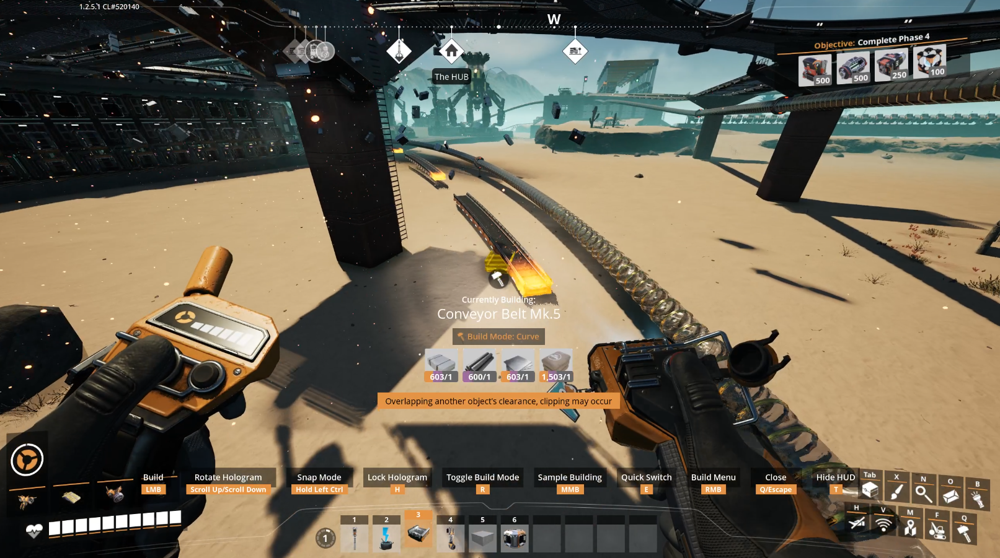
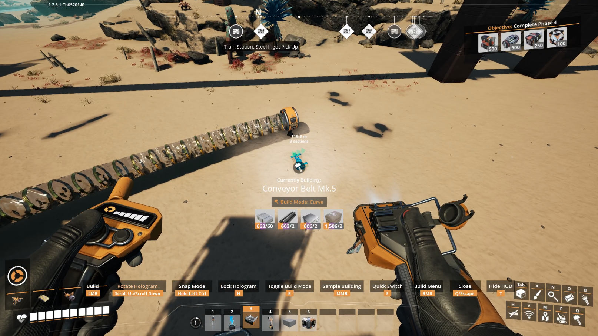

# Segmented Splines

A client-side Satisfactory mod. Drag a conveyor belt, pipe, hypertube or railway as far as you
like, past the per-piece length limit, and build it with one click. The mod cuts the curve you
aimed for into equal legal pieces and builds them one after another, with a support at every
joint and a readout of the full length and section count while you drag.

Because every piece the game receives is an ordinary, legal construction, it works when joining
a **vanilla dedicated server** that has no mods and no SML installed.

## What it does

* **Build past the limit.** A belt, pipe, hypertube or railway hologram longer than the limit no
  longer turns red. Click once and the mod builds it as the fewest equal pieces that fit under the
  limit (up to 32), each snapped to the previous one.
* **Supports at the joints.** Where there is floor under a joint, a pole of the right height is
  seated there; over a gap the joint is left free. While you drag, preview poles show where the
  joints will be.
* **The far end is placed by the game.** The last piece ends exactly where your cursor was, on a
  pole, wall or ceiling mount, or snapped to the machine, junction or wall hole you aimed at.
* **Length and section readout.** A label above the far end shows the full length in metres and
  how many sections it will be built as, for every belt, pipe or railway you drag.
* **Vanilla+.** Nothing about the game's rules changes. Under the limit, building is exactly
  vanilla. Blueprints, train platforms and the game's own bridge splines are left alone.

## Screenshots

A Mk.5 belt being built as three pieces across a canyon; the preview poles mark the joints:

The readout above the far end of a 120 m belt about to be built as three sections:

A one-minute demo of belt, hypertube and railway chains being built:
[docs/media/chain-demo.mp4](docs/media/chain-demo.mp4)

## Installing

Install it with the [Satisfactory Mod Manager](https://smm.ficsit.app/) from the mod's page on
[ficsit.app](https://ficsit.app/mod/SegmentedSplines). It needs SML 3.12 or newer and game
build 520140 (1.2.6) or newer. Nothing needs to be installed on a server you join.

## How it works on vanilla servers

Only the server constructs buildings. The client serialises its local hologram into a
construction message and the server re-validates it (length, slope, curvature, clearance, cost)
before building. This mod only ever changes the *local* hologram, so that each message the client
sends is a legal single piece. For a long spline it sends piece one, waits for the built piece to
replicate back, snaps the next hologram to its end connector, sends that, and so on.

* `RequiredOnRemote` is `false` in the `.uplugin`. SML 3.9+ clients refuse to join a server that
  lacks a mod marked required, which would lock you out of vanilla servers.
* A client with SML can join a server without SML (SML 3.8+).

The hooks are SML native hooks on `CheckValidPlacement`, `TrySnapToActor`,
`SetHologramLocationAndRotation` and `DoMultiStepPlacement` of the belt, pipeline and railroad
track hologram classes, plus the construction message serializer. Protected members are reached
through `Config/AccessTransformers.ini`. [CLAUDE.md](CLAUDE.md) is the detailed engineering
log: every run, every bug found and how each piece of the chain works.

## Known limits

* The far end of a chain is placed by the game from your last cursor hit. Aiming at something that
  the game itself refuses (for example two supports showing at once on a pillar) refuses the chain.
* A chain is at most 32 pieces. Longer than that, the hologram stays vanilla's red "too long".
* If the server rejects a piece, or a built piece does not replicate back within 60 seconds, the
  chain stops and leaves what was built. The log says why.
* The game's own bridge splines inside blueprints, and a train platform's track, are never
  chained. A blueprint placed too far from its connections shows red exactly as in vanilla.

## Building from source

Follow the official guide for your platform
(https://docs.ficsit.app/satisfactory-modding/latest/Development/BeginnersGuide/index.html).
In short:

1. Install the Coffee Stain custom engine (the `UnrealEngine-CSS-Editor-*` release that matches
   the current game build) and the Satisfactory Mod Loader starter project
   (`satisfactorymodding/SatisfactoryModLoader`). On Linux, the Win64 target needs MSVC through
   msvc-wine (`UE_WINE_MSVC`) and Wine.
2. Clone this repository into the starter project as `Mods/SegmentedSplines`. The folder name is
   the mod reference and must not change.
3. Build the `FactoryEditor` target once (the Access Transformers only take effect after a C++
   build), then package with Alpakit: target **Windows**, Alpakit Dev to copy the mod into your
   game's `FactoryGame/Mods/`, Alpakit Release to produce the zip for ficsit.app. The command-line
   equivalents are recorded in [CLAUDE.md](CLAUDE.md).
4. After every game update, compare the game log's `LogInit: Build:` changelist with the starter
   project's headers and rebuild. A mismatch makes the mod read the wrong fields and chains fail
   silently; the mod logs a warning when it detects this.

Logging goes to the `LogSegmentedSplines` category. Chain steps log at Log level; set the
category to Verbose in `Engine.ini` for every placement decision.

## Author

[krammark191](https://github.com/krammark191). Issues and suggestions:
https://github.com/krammark191/SegmentedSplines/issues
