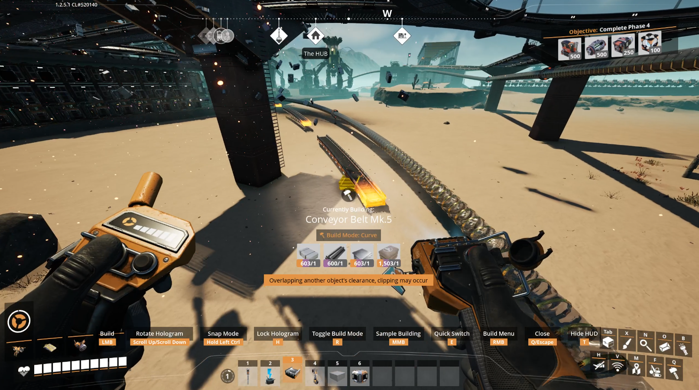
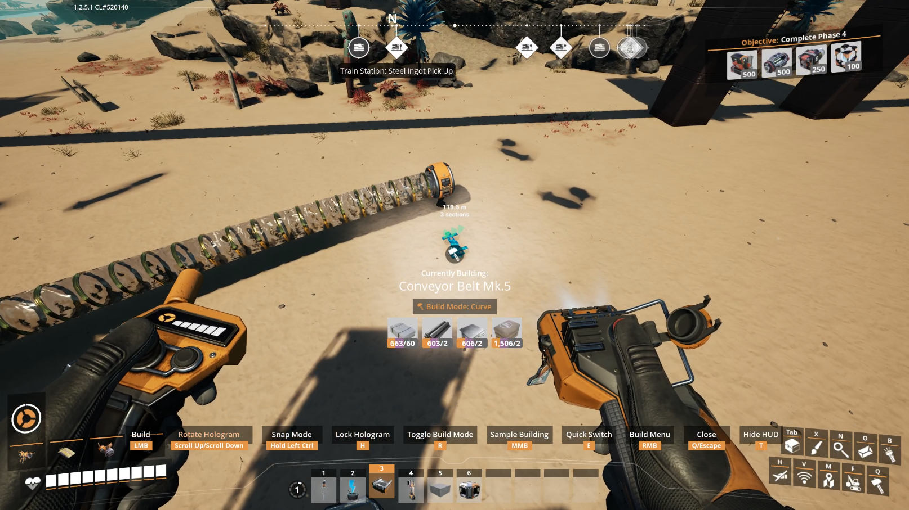

Drag a conveyor belt, pipe, hypertube or railway as far as you like, past the per-piece length limit, and build it with one click. The mod cuts the curve you aimed for into equal legal pieces and builds them one after another, with a support at every joint and a readout of the full length and section count while you drag.

**Works on vanilla dedicated servers.** Every piece the game receives is an ordinary, legal construction, so the server needs neither this mod nor SML.

## Features

* **Build past the limit.** A hologram longer than the limit no longer turns red. One click builds it as the fewest equal pieces that fit (up to 32), each snapped to the previous one.
* **Supports at the joints.** Where there is floor under a joint, a pole of the right height is seated there; over a gap the joint is left free. Preview poles show the joints while you drag.
* **The far end is placed by the game.** The last piece ends exactly where your cursor was: on a pole, a wall or ceiling mount, or snapped to the machine, junction or wall hole you aimed at.
* **Length and section readout.** A label above the far end shows the full length in metres and how many sections it will be built as.
* **Vanilla+.** Under the limit, building is exactly vanilla. Blueprints, train platforms and the game's own bridge splines are left alone.

## Screenshots

[One-minute demo video](https://github.com/krammark191/SegmentedSplines/blob/main/docs/media/chain-demo.mp4) of belt, hypertube and railway chains being built.

## How to use

Build a belt, pipe, hypertube or railway as usual and keep dragging. When the hologram is past the limit it stays valid and shows the length and section count. Click to build; the pieces appear one after another (about 150 ms each). The far end is placed exactly as you aimed it.

## Known limits

* A chain is at most 32 pieces; beyond that the hologram stays vanilla's red "too long".
* If the server rejects a piece, or a piece does not come back within 60 seconds, the chain stops and leaves what was built. The game log (`LogSegmentedSplines`) says why.
* Bridge splines inside blueprints and train platform tracks are never chained.

## Source and bug reports

https://github.com/krammark191/SegmentedSplines
